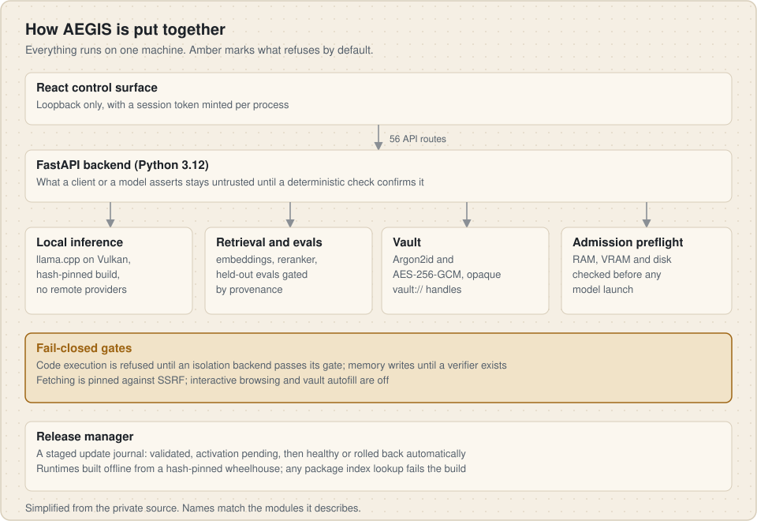

# AEGIS notes

How I am building a local-first AI workstation that refuses anything risky until it is proven safe, and the design for the OS layer it will run on.

These are written notes. The source is private, and nothing here is code from it.

## At a glance

| | |
|---|---|
| What it is | AEGIS runs AI work on my own PC: local models, retrieval, evaluations and a vault, behind a loopback-only API with a React control surface. Models draft; deterministic services decide. No model gets a shell, root or network access. |
| My part | I set the goals and the rules, approved every task card before work started, read each run's evidence and made the calls. AI coding agents wrote most of the code under that loop (see "How this was made"). |
| Stack | Python 3.12, FastAPI, React 18 with Vite, llama.cpp on Vulkan, Argon2id and AES-256-GCM, uv with a hash-pinned lock. Windows 11 today; Ubuntu LTS is the target for the OS layer. |
| Size | About 14,800 lines of Python in 28 modules, 56 API routes, about 14,000 lines of tests and 4,200 lines of TypeScript (2026-11-19). |
| Tests | Re-run on 2026-11-25: 443 collected, 438 passed, 5 skipped, 0 failed. Four of the skips need the offline wheelhouse; the record of 2026-11-19 with it present has 442 passed and 1 skipped. |

<picture>
  <source media="(prefers-color-scheme: dark)" srcset="diagrams/architecture-dark.svg">
  
</picture>

## What refuses by default

- **Code execution** raises an isolation error until a sandbox backend passes its gate. On Windows that gate is still a no-go, so the feature stays off.
- **Memory writes** are refused until a deterministic verifier exists.
- **Remote models.** There are no remote provider adapters, and subscription logins are never routed through AEGIS.
- **Claims.** Anything a client or a model asserts is untrusted until a deterministic check confirms it.
- **Supply chain.** Every dependency is pinned by hash. Runtimes are built offline from a verified wheelhouse, and any package index lookup fails the build.
- **Updates** go through a staged journal (validated, activation pending, then healthy or rolled back) with a runtime per release.

## Measured: local inference

One live service-level run on 2026-11-19: llama.cpp on Vulkan, a 9B model quantised to 5.97 GB, a Radeon RX 7700 XT with 12 GB, 30 measured requests in each of 6 cells and 0 errors.

| Prompt size | First token, p50 | First visible token, p50 | Decode, p50 |
|---|---|---|---|
| 512 tokens | 0.59 s | 5.18 s | 56.1 tok/s |
| 2,048 tokens | 1.72 s | 6.38 s | 55.3 tok/s |
| 8,192 tokens | 6.50 s | 11.40 s | 52.6 tok/s |

- The model reasons before it answers, so the first visible token comes several seconds after the first token.
- With n-gram speculative decoding the server's counter read 110 to 226 tok/s. That counter is not plain decode speed, and the speculative settings are not yet tested for answer quality, so I do not use it as a headline.
- Retrieval on the same machine: embedding p50 of 9.7 ms; hybrid search with a reranker p50 of 151.8 ms (n of 8 to 10 per cell).

## SCHED0: deciding which model job runs

A prototype for the next piece the OS layer needs. For each local-model job it answers ADMIT, QUEUE, REFUSE or PROPOSE_UNLOAD, with a one-sentence reason, a RAM and VRAM ledger and links to the measurements it used. It never launches or stops anything; it proposes and a person or a deterministic service decides.

Its evidence is a trace-driven simulation, not live traffic (2026-11-19):

- It found that the current launch check under-estimates the model server's RAM by 0.40 to 0.72 GiB and over-estimates its VRAM by 1.08 to 1.25 GiB.
- With a batch backlog, chat met its loose latency target 91.4% of the time against 84.1% before, because chat jumps the queue.
- Under memory pressure it put 0 of 5 model loads into overcommit, against 1 of 5 for the current check and 5 of 5 with none. The cost was fewer chat targets met (60.7% against 65.2%).
- 78 tests, a 2,000-case sweep with 0 reserve breaches, and byte-identical results across two runs. I did not re-run these for this page: the evidence they read stays outside the export.

## The OS layer: a design on Ubuntu, not a new kernel

The feasibility study asked whether AEGIS could become its own operating system. Its answer was no to a custom kernel and yes to a governed layer of services and interface on a stock Linux that boots beside Windows.

- **Why Ubuntu LTS.** When the study was written in November 2026, AMD listed ROCm support for this card only on Ubuntu 24.04.4, 22.04.5 and RHEL. The VM base uses 24.04.5, which still has to be checked against that list before the GPU milestone. Fedora Atomic had the best rollback and was the runner-up; NixOS was rejected for its maintenance load and Secure Boot story.
- **What is written, not adopted.** The base system, boot, snapshots, disk encryption and firewall come from the distribution. AEGIS adds the policy shell, a deterministic scheduler (SCHED0), a credential broker with leases, an agent sandbox and recovery drills.
- **The hard risks it names.** A boot change could trigger BitLocker recovery; a Hyper-V VM cannot test the GPU at all; nothing caps VRAM at runtime on Linux, so it has to be budgeted at launch.

| Milestone | State (2026-11-25) |
|---|---|
| M0 Facts and threat model | Done |
| M1 VM base and recovery | A Hyper-V Generation 2 VM with Ubuntu 24.04.5 installed and checked; a fill test and a reinstall drill remain |
| M2 AEGIS services on Linux in the VM | Planned |
| M3 Security and contention campaign | Planned |
| M4 Attended test on a spare disk, with the GPU | Planned |
| M5 Two weeks as my daily system | Planned |

## A trial that stopped where it should

On 2026-11-18 I staged a local coding-agent toolchain (an editor, an agent extension, a CPU build of llama.cpp and an 8B model) for a sandbox smoke test. All six files matched their pinned SHA-256 hashes and Defender found nothing. The run then stopped at its RAM gate, 3.90 GiB short, before anything was launched. The report also lists what the hashes do not prove: two vendor signatures were not checked, one tool publishes none, and the model has no independent provenance.

## What it does not do yet

- It is a private research build on one PC. Every number here comes from that machine.
- Every agentic capability is switched off on purpose until its gate passes.
- About a third of the Python is written against Win32 and PowerShell, so the move to Linux is real porting work.
- The speculative decoding and prompt cache settings shipped on before their ablations ran. That is recorded as a gap, not a feature.

## How this was made

A written loop between me and AI coding agents:

1. **Write.** Each task becomes a precise prompt plus a plain-English card: risk, assumptions, acceptance criteria and any rule it wants to change.
2. **Approve.** I approve each card, including any irreversible choice, before work starts.
3. **Build in isolation.** Work happens in disposable trees on a separate drive, behind write guards, and reaches the main tree only through hash-pinned promotion packages with rehearsed apply and rollback scripts.
4. **Report.** Every run ends with one status word (COMPLETE, PARTIAL or STOPPED_SAFE), its evidence, and what the next prompt should change.

The cards, prompts and run records stay private because they describe my machine.

## Licence

All rights reserved. See [LICENSE](LICENSE).
